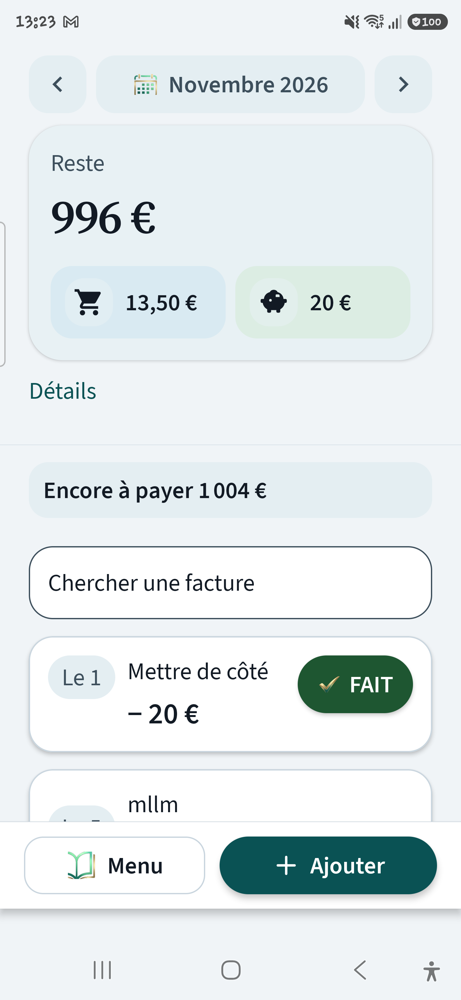
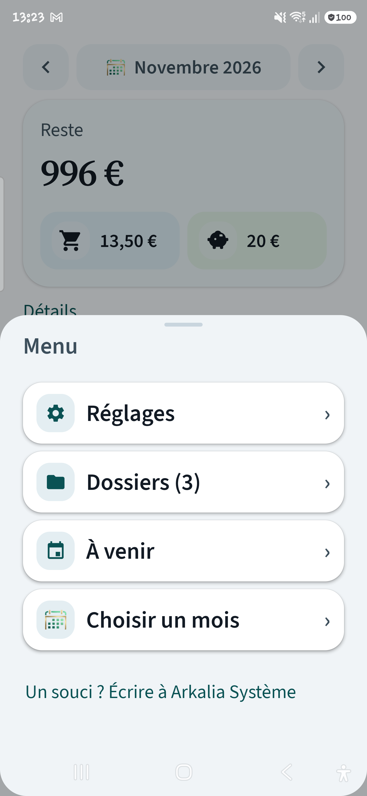
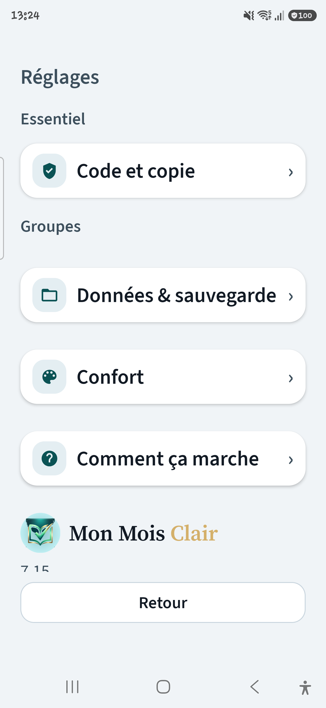

# Mon Mois Clair

**Le carnet du mois, sur le téléphone — pas une banque.**

Reste après factures · FAIT ✓ · rappels exacts · photo & PDF · **100 % hors ligne**.  
Pas de compte. Pas de cloud. Pas de pub.

Carnet familial belge (papier, QR EPC, communication structurée) — distribution via **Google Play Internal Testing**, APK sideload en secours. Validé sur Galaxy S25 Ultra (One UI).

[](https://kotlinlang.org)
[](https://developer.android.com)
[](https://developer.android.com/jetpack/compose)
[](https://github.com/arkalia-luna-system/mon-mois-clair/actions/workflows/ci.yml)
[](#statut)
[](#statut)
[](LICENSE)

<p align="center">
  
  &nbsp;
  
  &nbsp;
  
</p>

Un bloc-notes ne suffit pas pour voir **ce qu’il reste à vivre** et **ce qui reste à payer**.  
Mon Mois Clair reste sur l’appareil : saisie manuelle, base chiffrée, sauvegarde locale (JSON enveloppe + photos).  

Dépôt **public** (vitrine craft) · usage = familial / Play Internal. Aucun keystore ni APK versionné.

Bug, idée, question → Accueil → **Menu** → **Arkalia Système**.

---

## Ce que l’app fait

| | |
|--|--|
| **Reste sticky** | Lecture claire du mois · mist / teal / or · launcher & splash kit |
| **Factures** | Récurrence · FAIT le JJ/MM · En retard · Prélèvement · jour 1–31 |
| **Papier belge** | QR EPC · communication mod 97 · photo WebP · PDF courrier · OCR `+++` |
| **Accords** | Pastille · reste dû · IBAN · Écrire · frais datés · Mes dossiers |
| **Sérénité** | Backup SAF · biométrie · `FLAG_SECURE` · widget · encre de nuit · alertes |

**Hors scope volontaire :** banque ouverte, catégories marketing, graphiques, synchro cloud.  
Play = **piste Internal familiale** seulement — pas une publication Store grand public.

---

## Confidentialité

- Politique HTTPS (Play) : [privacy.html](https://arkalia-luna-system.github.io/mon-mois-clair-privacy/privacy.html)
- Détail technique : [`PRIVACY.md`](PRIVACY.md) — pas d’`INTERNET`, backups SAF, presse-papiers sensible
- Crypto locale : SQLCipher + Android Keystore · [`SECURITY.md`](SECURITY.md)

---

## Statut

| Élément | État |
|---------|------|
| Version | `0.1.0-7.34` (`versionCode` 140) |
| Dernière étape | **7.34** — audit expert craft 10/10 (API deprecated + remember Réglages) |
| Device | Baseline Galaxy S25 Ultra (SM-S938B), install release **7.16** sans wipe |
| Distribution | **Play Internal** + IAU Immediate — [`docs/PLAY_INTERNAL_TESTING.md`](docs/PLAY_INTERNAL_TESTING.md) · [`docs/IN_APP_UPDATES.md`](docs/IN_APP_UPDATES.md) · sideload [`docs/DISTRIBUTION_FAMILLE.md`](docs/DISTRIBUTION_FAMILLE.md) |
| AAB | `dist/MonMoisClair-release.aab` (gitignoré ; `./gradlew :app:bundleRelease`) |
| Tests unitaires | **425** passent, **1** `@Ignore` (migration 1→N), 0 failure — journal local `--rerun-tasks` 2026-11-05 |
| Schéma Room | **8** |

Non claimé ici (volontaire) : smoke doigt « cadeau », restore famille en conditions réelles, compte Play Console déjà provisionné.

Journal : [`PROGRESS_LOG.md`](PROGRESS_LOG.md) · Charte : [`CHARTE_ET_ARCHITECTURE.md`](CHARTE_ET_ARCHITECTURE.md) · Docs : [`docs/README.md`](docs/README.md) · Contribuer : [`CONTRIBUTING.md`](CONTRIBUTING.md)

---

## Stack

Kotlin · Jetpack Compose · Room (SQLCipher) · Hilt · CameraX / ML Kit barcode offline · SAF + WorkManager · `AlarmManager` exact · fuseau `Europe/Brussels` · package `be.monmoisclair.app`

---

## Build / install

```bash
export COPYFILE_DISABLE=1
# Volume T7 : préférer ./scripts/git-safe.sh <commande git>
./gradlew :app:testDebugUnitTest --rerun-tasks
./gradlew :app:bundleRelease   # → dist/MonMoisClair-release.aab (Play Internal)
./gradlew :app:assembleRelease # → dist/MonMoisClair-release.apk (secours sideload)
adb install -r dist/MonMoisClair-release.apk
```

`local.properties` / `keystore.properties` / `*.jks` jamais versionnés. APK/AAB dans `dist/` ignorés.  
CI : push **`develop`** (et `main`) → compile + tests. Push **`main`** → AAB Play **Internal** si secrets présents ([`docs/PLAY_INTERNAL_TESTING.md`](docs/PLAY_INTERNAL_TESTING.md)). Feuille de route : [`docs/CI.md`](docs/CI.md).

---

## Licence

[MIT](LICENSE) — © 2026 **Arkalia Luna** / [arkalia-luna-system](https://github.com/arkalia-luna-system).

<p align="center">
  <sub>Belgique · local-first · Play Internal familial · validé S25 Ultra</sub>
</p>
